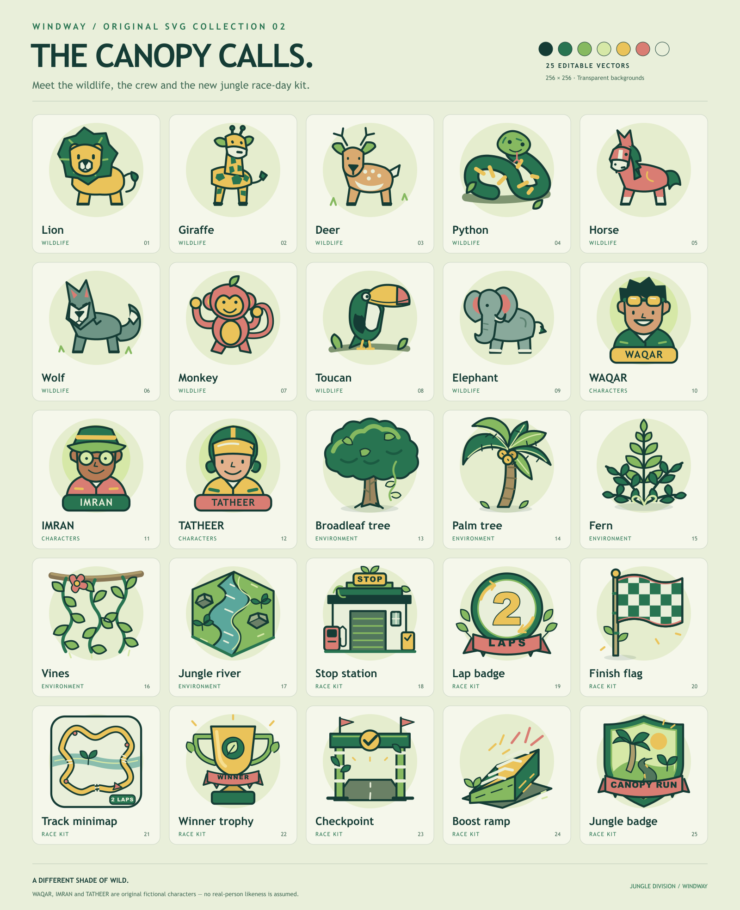

<p align="center">
  
</p>

<h1 align="center">Windway</h1>

<p align="center">
  <strong>Take the long way.</strong><br />
  A playful browser driving game about fast cars, strange company, and roads worth taking twice.
</p>

<p align="center">
  <a href="https://waqar-743.github.io/3D-Car-View/?map=jungle">Play Windway</a> ·
  <a href="https://waqar-743.github.io/3D-Car-View/jungle-pack/">Meet the jungle cast</a> ·
  <a href="docs/WILDWAY.md">Driver's guide</a>
</p>

## It started with a car you could only look at.

Windway began as a 3D car viewer: turn the camera, admire the bodywork, change the paint. Then the question changed.

**What if you could stop looking and start driving?**

That became the direction for this project. I wanted the garage to lead somewhere: a mountain bend, a river crossing, a road disappearing into trees. Not a serious racing simulator. A small, character-filled escape you can open in a browser.

I'm [Waqar Ahmed](https://github.com/Waqar-743), and Windway is my ongoing experiment in turning that idea into something playable. The original showroom is still in the source; the open road is now the main event.

## Pick a road. Give it a story.

| Road | The feeling | The challenge |
| --- | --- | --- |
| **The alpine loop** | Open mountain views, timber bridges, goats and eagles. Warm paper, sage and orange. | One lap, eight ordered gates, one orange boost jump. |
| **Canopy Run** | Dense broadleaf trees, palms, vines, jade water and tiny clearings. Jade, marigold and coral. | Two laps, every gate on both loops, and a short flight from the on-road ramp. |

Both roads have a live minimap, protected bridge edges, checkpoint recovery and a finish worth earning. The jungle adds a roadside ranger station and a cast of lions, giraffes, deer, pythons, horses, wolves, monkeys, toucans and elephants.

**WAQAR, IMRAN and TATHEER** are the original cartoon road crew. Their names are part of the game; their portraits are fictional designs, not assumed likenesses of real people.

## Two cars. Different attitudes.

The **McLaren MCL38** is the quicker launch and the livelier turn-in. The **Mercedes-AMG W14** trades some initial punch for a higher top speed and more grip. Pick your car, choose one of six paint colours, and take either route.

There are no opponents or multiplayer yet. This is a single-player time trial: your line, your mistakes, your next personal best. Records are saved separately for each map and car, on your own device.

## A little chaos. A dependable way back.

A marked ramp gives you a brief speed surge and intentional airtime. Ordinary driving stays planted. Bridge walls are physical barriers, not just scenery. If you leave an unprotected edge or end up in the river, the game returns you to your last earned checkpoint without erasing your current lap.

Chase and hood cameras, rotating wheels, drifting, dust, skid marks, and synthesized engine sounds give the road some life. Sound starts after your first interaction. Graphics quality, effects, volume and calmer motion are adjustable.

## Take the wheel locally

Use Node.js 20 or newer, then:

```sh
git clone https://github.com/Waqar-743/3D-Car-View.git
cd 3D-Car-View
npm ci
npm run dev
```

Open **http://127.0.0.1:4175/3D-Car-Design/**. Add **?map=jungle** to open Canopy Run directly. The local folder/base path is intentionally kept compatible with earlier previews; the published build uses the GitHub repository's actual path.

| What you want to do | Key |
| --- | --- |
| Accelerate | W / Up |
| Brake, then reverse | S / Down |
| Steer | A/D / Left/Right |
| Handbrake drift | Space |
| Return to the last earned checkpoint | R |
| Switch chase / hood camera | C |
| Pause / resume | Escape / P |

Touch steering and pedals are available on smaller screens and touch devices.

## The cast lives in SVG

The alpine collection has **36 editable SVGs**. The jungle adds **25**, including wildlife, the named crew, vegetation, river artwork, the station, lap badge, finish flag, minimap and winner's trophy.

[Browse the alpine collection](https://waqar-743.github.io/3D-Car-View/cartoon-pack/) or [open the jungle gallery](https://waqar-743.github.io/3D-Car-View/jungle-pack/). Each gallery offers larger previews and the actual vector files.

<details>
<summary>See the jungle cast and race-day kit</summary>



</details>

## Built to keep the road moving

Windway uses React, TypeScript, Three.js, React Three Fiber, Rapier and Zustand. Repeated trees and plants are instanced, physics steps at a fixed rate, and interface telemetry updates less often than rendering. The selected car loads on demand; there is no automatic panorama or second-car download.

The delivery car models are roughly 3 MiB each, with original source assets preserved. Light graphics reduce foliage, shadows and pixel density. Those are design choices, not a promise of a particular frame rate on every device.

```sh
npm run test:game
npm run build
npm run preview -- --host 127.0.0.1 --port 4175 --strictPort
```

The automated suite covers **120 checks**: driving and race state, both maps' bridge collisions, two-lap progression, saved records, SVG references, and headless rendering of the interface. Both cars complete simulated two-lap jungle runs. These tests do not replace browser, touch-device or frame-rate testing.

GitHub Actions builds and publishes the main branch to GitHub Pages. The deployed base path follows the repository name, so the public site does not accidentally request files from an old project URL.

## Follow the trail

- [Driver's guide and implementation notes](docs/WILDWAY.md)
- [Performance work and model optimization](docs/PERFORMANCE.md)
- [Model attribution and licenses](public/MODEL_CREDITS.md)
- [Archived car-viewer documentation](docs/LEGACY_VIEWER.md)

## A note on the cars

The car artwork is by [MattsActuallyUsefulModels](https://sketchfab.com/MattsActuallyUsefulModels), distributed under **CC BY-NC-SA 4.0**. The source links, original titles, optimization changes and license notices are in [MODEL_CREDITS.md](public/MODEL_CREDITS.md). The model license does not permit commercial use; modified model assets retain the same license.

Windway is an independent learning/demo project. It is not affiliated with Formula 1, McLaren, Mercedes-AMG or the model artist, and their names and marks belong to their respective owners.

---

Made by [Waqar Ahmed](https://github.com/Waqar-743). Still finding out what is around the next bend.
